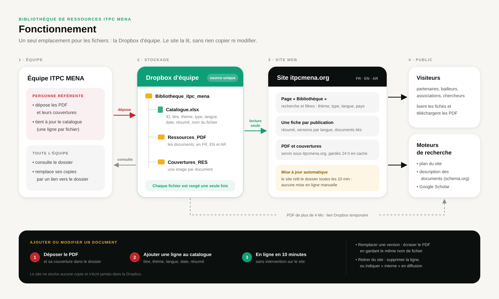

# Bibliothèque de ressources (`/bibliotheque`)

## Principe



Un seul emplacement de référence : le dossier **`Bibliotheque_itpc_mena`** de la
Dropbox d'équipe. L'équipe y range et consulte les documents ; le site lit ce même
dossier. Rien n'est copié dans le dépôt ni dans WordPress.

```
Bibliotheque_itpc_mena/            (dossier d'équipe Dropbox, à la racine de l'équipe)
├── Catalogue.xlsx                 ← une ligne par fichier (racine du dossier)
├── Ressources_PDF/…pdf            ← sous-dossiers libres
└── Couvertures_RES/RES-001.jpg …
```

- La liste `src/app/[locale]/bibliotheque/page.tsx` et les fiches
  `src/app/[locale]/bibliotheque/[slug]/page.tsx` lisent le catalogue et la liste des
  fichiers (`src/lib/bibliotheque.ts`), régénérées toutes les 10 minutes (ISR).
- URL publiques, toutes sous le domaine du site :
  - fiche d'une publication : `/fr/bibliotheque/res-011-indice-de-stigmatisation-…`
    (seul l'ID fait foi : si le titre change, l'ancienne adresse redirige en 308) ;
  - PDF : `/bibliotheque/pdf/RES-011.pdf`, lu dans Dropbox puis gardé en cache disque
    sur le serveur (`.cache/bibliotheque/`, ou `BIBLIO_CACHE_DIR`). Le fichier de cache
    porte l'empreinte Dropbox du contenu : Dropbox n'est relu que si le PDF change ;
  - couverture : `/bibliotheque/couverture/RES-011.jpg`.
- Si la source est absente ou en erreur, la page affiche un message d'indisponibilité
  et les erreurs sont journalisées sous `[bibliotheque]`.

## Référencement

- Une fiche indexable par publication : titre, description (≈155 caractères),
  couverture en image de partage, liens hreflang FR/EN/AR (même segment d'URL).
- Données structurées schema.org : `CollectionPage` + `ItemList` sur la liste,
  `Report` (ou `CreativeWork` pour guides et boîtes à outils) sur chaque fiche, avec
  un `MediaObject` par version PDF, et le fil d'Ariane.
- Balises `citation_*` (Google Scholar) sur les fiches ; l'auteur déclaré est
  ITPC-MENA faute de colonne « Auteurs » dans le catalogue.
- Les fiches sont dans le sitemap. Les filtres de la liste sont reportés dans l'URL
  (`?theme=…&lang=…`) pour le partage ; l'URL canonique reste celle sans paramètres.
- Les pages EN et AR n'ont de valeur propre que si les colonnes « Descriptif EN /
  Descriptif AR » sont remplies : à défaut elles reprennent le résumé français.

## Catalogue

Classeur `.xlsx` à la racine du dossier. S'il y en a plusieurs, le premier qui
possède les colonnes ID, Titre et Nom du fichier est retenu (ceux dont le nom contient
« catalogue » sont essayés en premier). Première feuille, en-têtes en ligne 1,
reconnus sans tenir compte de la casse ni des accents :

| Colonne | Obligatoire | Rôle |
|---|---|---|
| ID (site) | oui | Identifiant stable (`RES-014`), utilisé dans les URL |
| Thématique | oui | Filtre principal (pastilles) |
| Type de support | oui | Filtre « Type » |
| Titre du document | oui | Titre affiché pour cette version |
| Descriptif | oui | Résumé (français) |
| Langue | oui | Français / Anglais / Arabe |
| Date de publication | oui | « 2025 », « Mars 2024 », « 7 novembre 2025 » ou date Excel |
| Nom du fichier | oui | Nom exact du PDF dans le dossier (sinon, PDF dont le nom commence par l'ID) |
| Ref. image | non | Nom de la couverture (sinon, image dont le nom commence par l'ID) |
| Groupe de traduction (ou Publication) | non | Regroupe les versions linguistiques : même valeur pour toutes les traductions (ID de la version de référence), ID propre pour un document sans traduction. Une seule fiche par groupe, affichée dans la langue de la page si elle existe. À défaut de colonne : même thématique + type + descriptif |
| Titre FR / Titre EN / Titre AR | non | Titre traduit, à remplir seulement pour les langues dans lesquelles le document n'existe pas (le titre d'une version existante reste prioritaire). Affiché sur la page de cette langue ; la fiche indique la langue réelle du PDF |
| Descriptif EN / Descriptif AR | non | Résumés traduits ; à défaut, le résumé français est affiché |
| Pays | non | Codes ou noms séparés par des virgules ; à défaut, détectés dans le titre et le résumé |
| Diffusion | non | Vide ou « public » = en ligne ; toute autre valeur (interne, partenaires) = hors site |

Les libellés EN/AR des thématiques, types et pays sont dans
`src/lib/bibliothequeLabels.ts`. Une nouvelle thématique saisie dans le catalogue
s'affiche telle quelle (en français) tant qu'elle n'y est pas ajoutée.

## Gestion courante (personne référente)

- **Ajouter un document** : déposer le PDF (et sa couverture) dans le dossier, ajouter
  une ligne au catalogue. En ligne dans les 10 minutes.
- **Remplacer une version** : écraser le PDF en gardant **le même nom de fichier**.
- **Retirer un document** : supprimer sa ligne, ou mettre « interne » dans Diffusion.
- Ne pas renommer un fichier sans mettre à jour la colonne « Nom du fichier ».

## Mise en place de l'accès Dropbox (une fois)

0. Le dossier est un **dossier d'équipe** créé dans la console d'administration
   (Contenu → Créer un dossier d'équipe), et le compte qui autorise l'application
   (étape 3) doit figurer **dans sa liste d'accès** (Gérer l'accès → Peut consulter).
   Être administrateur de l'équipe ne suffit pas : le jeton n'agit qu'avec les droits
   de membre de ce compte. Symptôme sinon : `files/list_folder 409 path/not_found`.
   Compte qui porte le jeton actuellement : imad.eloualidi@itpcmena.org (08/10/2026).
   Le même compte autorise l'application `itpcmena-poc-corpus` du POC de corpus et RAG
   (serveur dédié, lecture seule) : retirer ce compte de la liste d'accès coupe les deux.

1. Console développeur Dropbox → *Create app* → **Scoped access**, **Full Dropbox**
   (un « App folder » ne voit pas les dossiers d'équipe). Nom : `itpcmena-site-bibliotheque`.
2. Onglet *Permissions* : cocher `account_info.read`, `files.metadata.read`,
   `files.content.read` (lecture seule), puis *Submit*.
3. Obtenir le jeton de rafraîchissement, avec le compte qui autorise (membre de
   l'équipe ayant accès en lecture au dossier de la bibliothèque) :
   ```bash
   node scripts/dropbox-refresh-token.mjs <APP_KEY>          # affiche un lien
   node scripts/dropbox-refresh-token.mjs <APP_KEY> <CODE>   # affiche le jeton
   ```
4. Variables d'environnement de l'application itpcmena sur aout.app :
   ```
   DROPBOX_APP_KEY=…
   DROPBOX_REFRESH_TOKEN=…
   DROPBOX_BIBLIO_PATH=/Bibliotheque_itpc_mena
   ```
   Le chemin est relatif à la racine de l'équipe : le code se place lui-même dans
   l'espace d'équipe (`Dropbox-API-Path-Root`).
5. Révocation : supprimer l'application dans les réglages du compte qui l'a autorisée
   (*Applications connectées*), ou dans la console développeur.

## Hébergement

- Front Next.js déployé sur aout.app (`next start`, nginx en frontal) ; CMS WordPress
  sur `wphead.itpcmena.org` (serveur Plesk). La bibliothèque ne passe pas par WordPress.
- Le dossier de cache disque doit être accessible en écriture par l'utilisateur qui
  fait tourner l'application. Il peut être vidé à tout moment : il se reconstitue.
- Optionnel : un `proxy_cache` nginx sur `/bibliotheque/pdf/` et
  `/bibliotheque/couverture/` évite même de solliciter Node (les réponses portent
  déjà `Cache-Control: public`).

## Développement local

Sans Dropbox, pointer sur un dossier qui a la même organisation :

```bash
BIBLIO_LOCAL_DIR=~/Desktop/test/biblioitpc npm run dev
```

Les variables Dropbox, si elles sont toutes présentes, ont la priorité.
